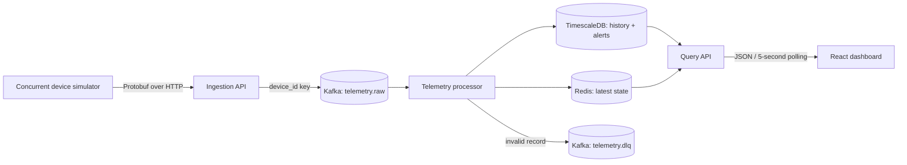

# PulseGrid — Fleet Signal Monitor

A local device-signal monitoring system for ingesting device signals, keeping their history, and surfacing threshold alerts. Simulated devices send binary Protobuf messages through FastAPI and Kafka; a React dashboard reads the resulting state from Redis and TimescaleDB through a separate Query API.

The demo uses temperature and humidity signals. The same ingestion and processing pattern can support other equipment metrics when their contracts and alert rules are defined.

## Architecture



## Capabilities

- Send continuous telemetry from several simulated devices concurrently.
- Switch devices in the dashboard and view latest readings and recent history.
- Trigger warning or critical threshold breaches and inspect persisted alerts.
- Inspect an invalid Kafka record's dead-letter envelope; its source offset advances only after the DLQ publish is acknowledged.
- Follow an event from its Protobuf contract through Kafka to both read stores.
- Explain partition ordering, manual offset commits, and duplicate-safe database writes.

The stack includes Python, FastAPI, Protobuf, Kafka, Redis, TimescaleDB/PostgreSQL, React, TypeScript, Recharts, Vite, and Docker Compose. It is a local MVP; a public hosted instance is not yet available.

## Run the full Docker demo

Install and start Docker Desktop, then run from the repository root:

```bash
git clone https://github.com/ask-kumbar/PulseGrid.git
cd PulseGrid
docker compose -f compose.demo.yaml up --build -d --wait
```

Open [the dashboard](http://localhost:8080). A new demo has no readings until you send events:

```bash
docker compose -f compose.demo.yaml run --rm simulator --devices 3 --count 30 --interval 1
```

Switch between `sensor-204`, `sensor-205`, and `sensor-206` in the dashboard. Send a deliberate critical-temperature event:

```bash
docker compose -f compose.demo.yaml run --rm simulator --devices 1 --count 1 --scenario temperature-critical
```

The dashboard polls every five seconds, so allow a refresh cycle for the reading and alert to appear. Use `--count 0` for continuous simulation and stop it with `Ctrl+C`.

Run the real-stack smoke check to send isolated test traffic and verify ingestion, validation, processing, replay-safe storage, and tenant-scoped reads:

```bash
docker compose -f compose.demo.yaml run --rm --entrypoint python simulator -m scripts.smoke_demo
```

The smoke check creates a unique test tenant and leaves its small set of records in the demo database. It is a behavior check, not a throughput benchmark.

Check services or stop the demo while retaining its named data volumes:

```bash
docker compose -f compose.demo.yaml ps
docker compose -f compose.demo.yaml down
```

`compose.demo.yaml` is standalone and uses a separate Compose project from the development stack. Do not combine the two Compose files. The demo exposes the dashboard on port `8080` and ingestion on port `8081` on loopback; database, Redis, Kafka, and Query API connections remain inside its Docker network. Keep this unauthenticated demo local until access controls and HTTPS are configured for hosting.

Optional settings are in `.env.demo.example`. To customize them, copy it to `.env.demo`, edit the values, and use it in every demo command:

```bash
docker compose --env-file .env.demo -f compose.demo.yaml up --build -d --wait
```

Keep `.env.demo` out of Git. The default credentials are for this local demonstration only.

## Develop locally

Use this workflow when you want to edit and understand each service individually. Requirements: Docker Desktop, Python 3.12+, and a Node.js version supported by the dashboard's Vite dependency.

```bash
python3.12 -m venv .venv
source .venv/bin/activate
python -m pip install -e ".[dev]"
docker compose up -d kafka redis timescaledb
```

Create the development topics once:

```bash
docker compose exec kafka /opt/kafka/bin/kafka-topics.sh \
  --bootstrap-server localhost:9092 \
  --create --if-not-exists \
  --topic telemetry.raw --partitions 3 --replication-factor 1

docker compose exec kafka /opt/kafka/bin/kafka-topics.sh \
  --bootstrap-server localhost:9092 \
  --create --if-not-exists \
  --topic telemetry.dlq --partitions 3 --replication-factor 1
```

In three separate terminals, activate `.venv` from the repository root and run one command per terminal:

```bash
uvicorn services.ingestion_api.main:app --reload
```

```bash
python -m services.telemetry_processor.main
```

```bash
uvicorn services.query_api.main:app --reload --port 8001
```

In a fourth terminal, start the dashboard:

```bash
cd dashboard
npm ci
npm run dev
```

Open [localhost:5173](http://localhost:5173). In a fifth terminal, from the repository root with `.venv` active, send sample traffic:

```bash
python -m services.device_simulator.main --devices 3 --count 30 --interval 1
```

Vite forwards `/api` requests to the Query API on port `8001`. The development ingestion API uses port `8000`. See the [command guide](docs/command-guide.md) for environment setup, Protobuf regeneration, existing database migrations, and inspection commands.

## API surface

| Endpoint | Purpose |
| --- | --- |
| `POST /v1/telemetry` | Validate Protobuf telemetry and publish it to Kafka; return a Protobuf acknowledgement |
| `GET /v1/tenants/{tenant_id}/devices` | Discover devices from their stored history |
| `GET /v1/tenants/{tenant_id}/devices/{device_id}/latest` | Read the last processed state from Redis |
| `GET /v1/tenants/{tenant_id}/devices/{device_id}/history` | Read history, with `hours`, `metric`, and `limit` filters |
| `GET /v1/tenants/{tenant_id}/alerts` | Read alerts, with `status`, `severity`, `device_id`, and `limit` filters |
| `GET /health` | Liveness endpoint on each API service |

## Processing guarantees and limits

The ingestion API validates each Protobuf message, then returns `202` after Kafka acknowledges the event. This does not mean the processor has already stored it. The processor revalidates decoded Kafka events, writes history/alerts and Redis state, then commits its Kafka offset. A failure before the commit can cause an event to be processed again.

History rows use `(event_id, metric, observed_at)` as their unique key, and alerts use `(event_id, metric)`. Replaying the same event therefore does not add duplicate rows. This is at-least-once processing with idempotent database inserts, not an exactly-once transaction across Kafka, Redis, and PostgreSQL.

If a Kafka record cannot be decoded or fails semantic validation, the processor publishes a JSON envelope to `telemetry.dlq` before committing the source offset. The envelope preserves source metadata and Base64-encoded key/payload bytes for inspection. Kafka keys events by `device_id`, preserving their append order within a partition. The demo uses one broker, three partitions per telemetry topic, and replication factor one. Redis holds the last processed event per tenant/device; it does not currently reject late events based on their observation timestamp. Alerts are recorded as active; acknowledgement and automatic resolution are future work.

Thresholds live in [config/alert_rules.yaml](config/alert_rules.yaml). These are demonstration values, not validated equipment safety limits. The dead-letter queue does not yet provide automated review or replay tooling. Authentication, authorization, high availability, and measured large-scale performance also remain outside this MVP.

## Verification

Run the Python tests from the repository root:

```bash
python -m pytest -q
```

These tests use fakes for Kafka, Redis, and TimescaleDB. They verify application behavior without Docker; they do not replace testing the real Docker pipeline.

Check and build the dashboard from `dashboard/`:

```bash
npm run lint
npm run build
```

## Project notes

- [Architecture decisions and remaining work](docs/build-plan.md)
- [Command guide](docs/command-guide.md)
- [Dashboard development](dashboard/README.md)

## License

[MIT](LICENSE), as recorded in this repository's license file.
